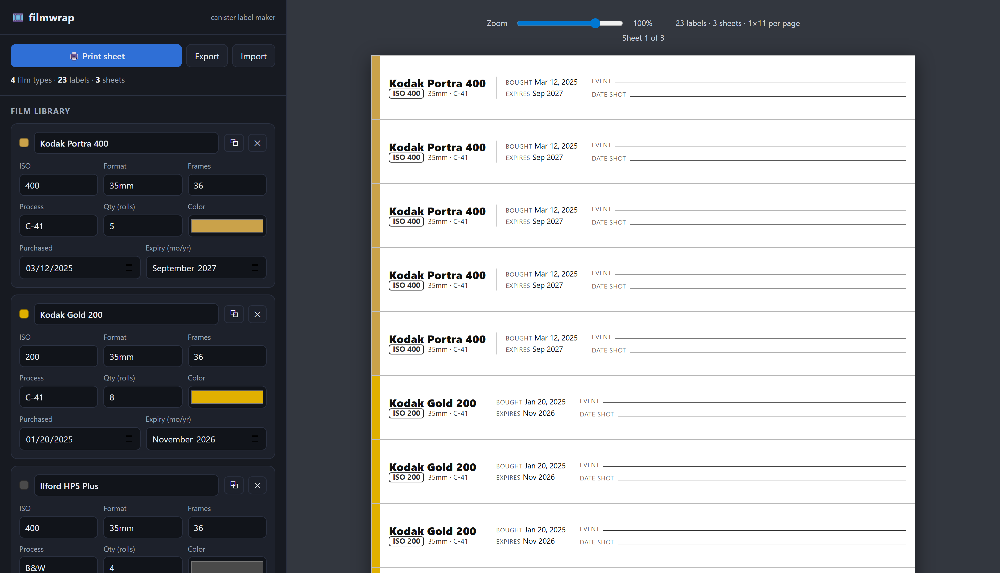

# filmwrap

A small web app that prints wrap-around labels for 35mm film canisters.



I shoot a fair amount of expired film, and a 35mm cassette doesn't tell you when
it was bought or when it expires. I'd been handwriting those dates on the
canisters, so I made this to print tidy labels instead. Each label is a thin
strip: it prints the stuff I already know (film name, ISO, format, process,
purchase date, expiry) and leaves blank lines for the things I fill in later, the
event and the date I shot it. You cut a strip out, wrap it around the roll, and
tuck it into the canister tube.

It's a single `filmwrap.html` file. No install, no build, no server. Open it in a
browser and go. Your film library is saved locally in the browser, and you can
export/import it as JSON.

## Using it

1. Open `filmwrap.html` in your browser (double-click it).
2. Add your films: name, ISO, format, frames, process, purchase date, expiry,
   how many rolls, and a color. ("Load sample films" drops in a few examples.)
3. Tweak the strip size if you want, check the preview, and click Print sheet.
4. Cut along the guide lines, wrap a strip around each roll, and put it in the tube.
   Write the event and date after you've shot it.

### Print settings

In the browser print dialog, match the paper size, set **Margins: None** and
**Scale: 100%**, and turn on **Print backgrounds** for the color accent bars.
The sheet uses real inches, but browser and printer settings can still rescale or
clip it. Measure a test strip before printing a full batch. If your printer cannot
print to the edge, increase the app's margin while leaving the dialog margin at
None.

### Saving and recovery

The save status below the print controls tells you whether changes were saved in
this browser. If storage is unavailable or full, you can keep editing and printing;
**Export a backup before closing the page** so you don't lose the current work.
An unreadable previous save is kept unchanged. Download the original data if
available, then explicitly choose **Replace saved data** to save the current library.

If another tab changes or removes the saved data, this tab reports a save
conflict and keeps its edits in memory. Export this tab's work, then reload to
load the latest saved library. Stale edits, imports, undo, and recovery replacement
cannot overwrite a changed save. This is a comparison before each localStorage
write, not a transactional multi-user store; avoid editing simultaneously in
multiple tabs and keep backups.

Import shows the incoming film and label counts and asks before replacing the
current library and its settings; it does not merge libraries. Delete, Clear all,
and Import can each be undone until the next edit or page reload. Keep an exported
backup for recovery beyond that point.

Size controls keep a single accepted value for the preview, export, and reload.
An empty number field restores its last valid value when you leave it; out-of-range
values are clamped when committed. Dimensions outside the paper's usable area
still show a clipping warning.

## Features

- Film library with add / duplicate / delete. Each film tracks brand, ISO, format,
  frame count, process (C-41 / E-6 / B&W), purchase date, expiry, roll count, and a
  color accent for sorting at a glance.
- Strips auto-stretch to the page width by default; turn that off for a fixed length,
  or use the wrap calculator (canister diameter x wraps).
- Cut-line grid so you can cut straight lines.
- Live preview with zoom, Letter or A4, adjustable margin / strip height / gap /
  font / text size, and toggles for which fields print.
- Saves to the browser automatically, with JSON export/import for backups or moving
  between machines.
- Reports save failures, protects unreadable saved data, and offers undo after
  deleting, clearing, or importing a library.
- Labeled controls, a stacked layout on narrow screens, and preview zoom without
  rebuilding the labels.

## Privacy

It runs entirely offline and makes no network requests. The library lives in your
browser's `localStorage`, not in the HTML file. Moving the file or using another
browser can give it a different storage location. Export gives you a JSON backup;
import restores it or copies it to another browser.

## Tests

It's plain HTML/CSS/JS in one file, so just edit `filmwrap.html`. There's a
Playwright suite (`test_filmwrap.py`) that drives the page in headless Chromium and
checks editing, persistence failures, import/delete recovery, and geometry after
reload. It verifies all 23 sample labels in a three-page Letter PDF and a separate
A4 PDF with margins, gaps, two columns, and a partially filled final page. All
test profiles are temporary, fixtures use synthetic data, and HTTP(S) requests are
blocked and reported as failures. Physical printer output still needs a measured
test strip.

```bash
pip install -r requirements-dev.txt
playwright install chromium
python test_filmwrap.py
```

## License

[MIT](LICENSE), Copyright 2026 Kameron Markham.
